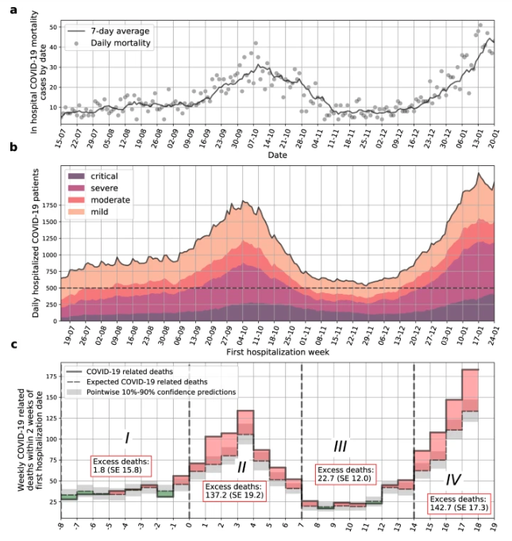

**During the COVID-19 pandemic, public-health decisions had to be made before all the evidence was available.** At the **Segal Lab, Weizmann Institute of Science (2020–2021)**, I developed models and analyses to help understand hospital demand, patient outcomes, and the population-level response.

## When hospital pressure changes patient outcomes

A central question was whether rising hospital load was associated with worse outcomes, beyond differences in who was being admitted. For example, a planning team might need to know whether a surge was approaching a level at which patient outcomes could deteriorate.

We combined multistate survival modeling with nationwide records of **22,636 hospitalized patients**. The models represented patients' movement between clinical states and compared observed mortality with predictions accounting for patient characteristics.

Periods with more than 500 severe or critical patients hospitalized nationally were associated with increased mortality compared with lower-load periods. This provided evidence that the consequences of hospital pressure could emerge below the official capacity threshold of 800. The finding describes an association from observational data.

**Hospital load and increased COVID-19 related mortality in Israel**\
Hagai Rossman\*, Tomer Meir\*, and colleagues · *Nature Communications, 2021*\
[Paper](https://www.nature.com/articles/s41467-021-22214-z) · [Code](https://github.com/tomer1812/covid19-israel-multi-state-hospitalization-model)\
*\*Equal contribution.*

*Hospital burden and observed versus predicted mortality across the study period.*

## Surveillance and vaccine impact

With limited testing capacity, we used national symptom surveys to help identify who should be prioritized for a test. We also studied changes in pandemic dynamics following vaccine rollout, providing population-level evidence alongside the hospital-outcome research.

- [Symptom-based testing prioritization](https://www.sciencedirect.com/science/article/pii/S2666634020300192) · *Med, 2020.*
- [COVID-19 dynamics after a national immunization program in Israel](https://www.nature.com/articles/s41591-021-01337-2) · *Nature Medicine, 2021.*
- [International symptom-surveillance consortium](https://www.nature.com/articles/s41591-020-0929-x) · *Nature Medicine, 2020.*
