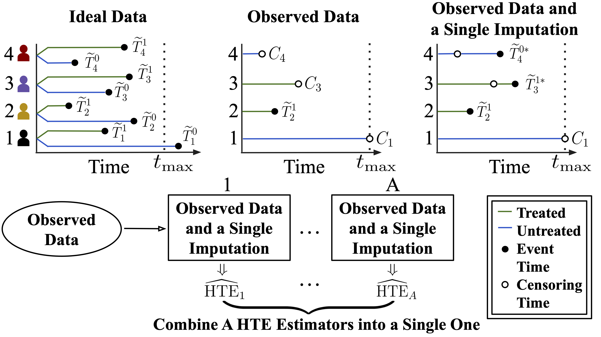

**A treatment that works well on average may benefit some patients much more than others.** Understanding those differences is a step toward personalized medicine. But when the outcome is time until disease progression or death, many patients have not experienced the event when follow-up ends. We know they remained event-free for a period, but not their eventual outcome. This incomplete observation is called *right-censoring*.

## A motivating example: comparing HIV treatments

The ACTG 175 trial followed 2,139 people with HIV assigned to four treatment strategies. Beyond asking which treatment worked best overall, we asked how its benefit varied with patient characteristics. This requires comparing outcomes under alternative treatments while making use of patients whose follow-up was incomplete.

Discarding those patients loses information; treating their last follow-up as the event time gives the wrong answer. Heavy censoring makes the problem especially difficult.

## What we developed

**MISTR (Multiple Imputation for Survival Treatment Response)** uses survival trees to generate several plausible completions of the missing event times. It estimates treatment effects in each completed dataset and combines the results. This allows treatment-effect learning without directly estimating the censoring distribution.

## What we accomplished

MISTR improved estimation under heavy censoring in simulations and semi-synthetic experiments based on MIMIC-IV patient data. We also applied it to the HIV trial to explore differences in treatment benefit, without claiming that individual treatment effects were directly observed.

An extension uses a valid instrumental variable to address unobserved confounding. We evaluated that extension in simulations and an unemployment-benefit study, showing how the framework can extend beyond randomized clinical trials.

*Multiple imputation makes incomplete survival outcomes usable for heterogeneous treatment-effect estimation.*

## Paper and code

**Heterogeneous Treatment Effect in Time-to-Event Outcomes: Harnessing Censored Data with Recursively Imputed Trees**\
Tomer Meir, Uri Shalit, Malka Gorfine\
*ICML, 2025*

[Paper](https://arxiv.org/abs/2502.01575) · [ICML](https://icml.cc/virtual/2025/poster/45413) · [Code](https://github.com/tomer1812/mistr)
