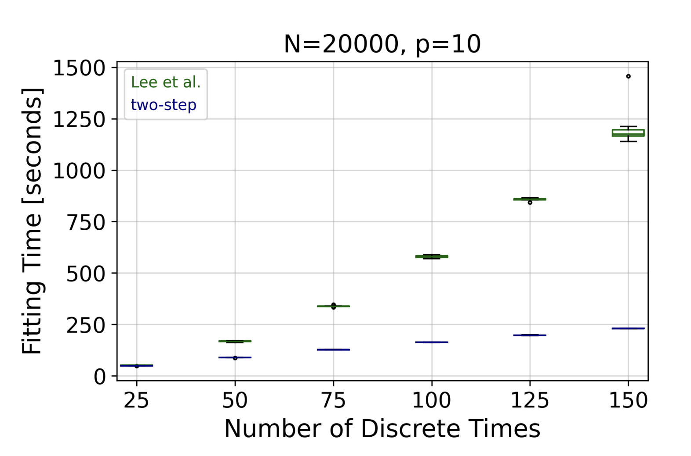

**For an intensive care team, knowing how long a patient may stay is only part of the question.** Will they go home, move to another facility, or die in hospital? Understanding both the timing and type of outcome can inform care planning and hospital resource needs.

## Why the outcomes must be modeled together

These are *competing events*: once a patient has been discharged, in-hospital death is no longer a possible outcome for that admission. Hospital records also often measure time in whole days. Methods need to respect both features, rather than treating the data as ordinary prediction targets or precisely measured continuous event times.

## From a statistical method to a practical toolkit

We developed a **two-stage regression procedure** that separates estimation of patient-characteristic effects from time-specific baseline risks. This makes fitting more efficient and supports regularization and feature screening, which help identify useful predictors among many recorded variables.

We then built **PyDTS**, an open-source Python package, so researchers can fit these models, select predictors, tune settings, and assess their predictions without implementing the methods from scratch. It also supports time-dependent covariates and generating synthetic data for new studies.

## What we accomplished

Simulation studies evaluated estimation accuracy and confidence-interval coverage while demonstrating faster fitting than the comparison procedure. In an application to **25,170 MIMIC-IV ICU admissions**, we modeled length of stay and the probabilities of discharge home, transfer, and in-hospital death over 28 days.

Together, the methods and software provide a reproducible way to study when different patient outcomes occur, with a concrete application to intensive-care data.

[Documentation](https://tomer1812.github.io/pydts/) · [GitHub](https://github.com/tomer1812/pydts) · [PyPI](https://pypi.org/project/pydts/)

*Fitting-time comparison from the regression-methods study.*

## Papers

**Discrete-time Competing-Risks Regression with or without Penalization**\
Tomer Meir, Malka Gorfine\
*Biometrics, 2025* · [Paper](https://doi.org/10.1093/biomtc/ujaf040) · [Study code](https://github.com/tomer1812/DiscreteTimeSurvivalPenalization)

**PyDTS: A Python Package for Discrete-Time Survival Analysis with Competing Risks and Optional Penalization**\
Tomer Meir, Rom Gutman, Malka Gorfine\
*Journal of Open Source Software, 2025* · [Paper](https://doi.org/10.21105/joss.08815)
