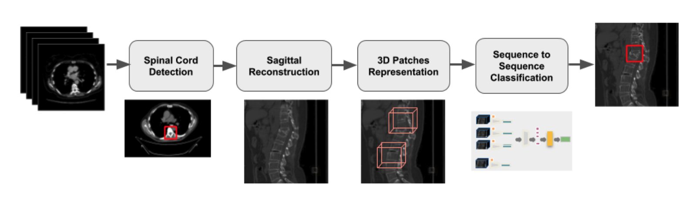

**A CT scan taken for another reason can also reveal an overlooked vertebral fracture.** Such a finding can be an early sign of osteoporosis and an opportunity for further assessment. The challenge is to identify these fractures reliably across large volumes of routine imaging.

## Finding useful signals in existing scans

At **Zebra Medical Vision**, I helped develop an automated system for identifying vertebral compression fractures in CT. The motivating use case is to flag scans for further review, helping clinicians find patients who may benefit from osteoporosis evaluation.

## The approach, at a glance

Processing an entire 3D scan is computationally demanding. Our system first locates the spinal cord and creates a compact representation of the spine. A 3D convolutional sequence model then analyzes vertebral patches together to classify the scan.

## What we accomplished

We compared different representations and model architectures. An ensemble achieved a **patient-level AUC of 0.955**, measuring how well it distinguished scans with and without fractures in the study's evaluation dataset.

The work demonstrated a way to extract clinically relevant findings from existing CT scans, with potential to support earlier osteoporosis assessment.

*From a full CT scan to a compact spine representation and fracture prediction.*

## Paper

**3D Convolutional Sequence to Sequence Model for Vertebral Compression Fractures Identification in CT**\
David Chettrit\*, Tomer Meir\*, Hila Lebel, Mila Orlovsky, Ronen Gordon, Ayelet Akselrod-Ballin, Amir Bar\
*MICCAI, 2020* · *\*Equal contribution.*

[Read the paper](https://arxiv.org/abs/2010.03739)
